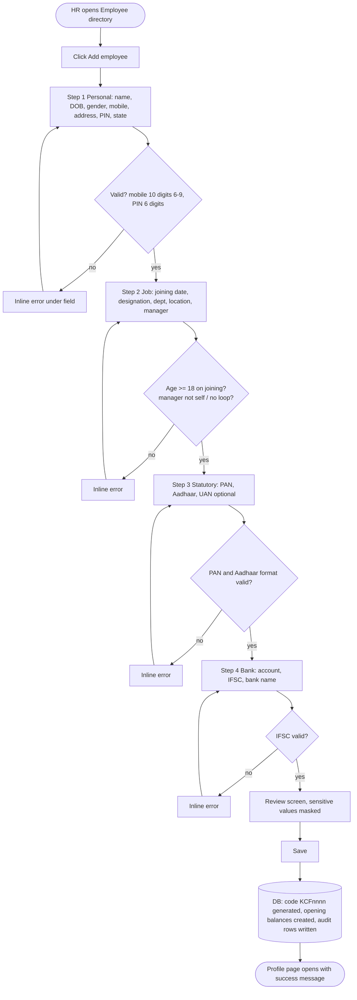
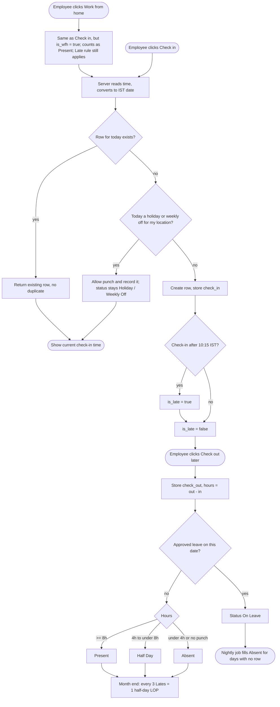
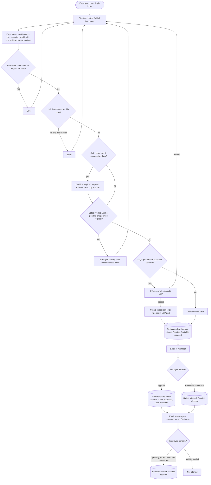
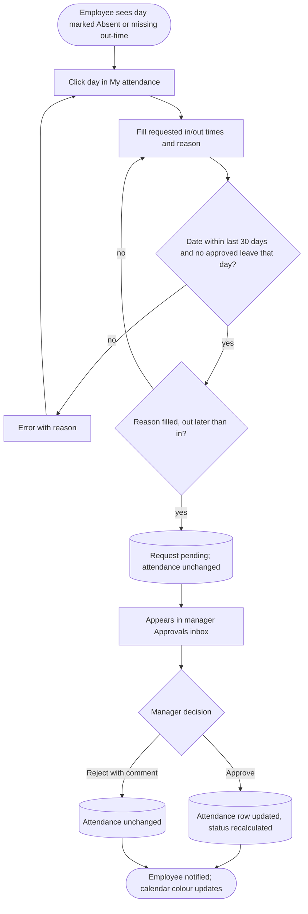

# DESIGN.md — Tarang HRMS (Konkan Coastal Foods)

Status: **v0.3, updated after the build (2026-10-23) · awaiting faculty sign-off** · first drafted 2026-10-17. Section 7 lists where the built app differs from this design.
Companion to [ARCHITECTURE.md](ARCHITECTURE.md) and [RESEARCH.md](RESEARCH.md). Rule numbers (R1–R35) refer to RESEARCH.md §11. v0.2 adds the screens the review found missing (§2.15–2.20) and the WFH and cancel flows.

> Ownership note: review and redraw anything you cannot explain. Wireframes are deliberately low-fidelity.

---

## 1. User flows

### 1.1 Add employee (HR Admin)



### 1.2 Check-in to day status



### 1.3 Apply leave to approval to balance update



### 1.4 Missed punch to regularisation



---

## 2. Wireframes (low fidelity)

Legend: `[ ]` button/field, `( )` option, `▓` filled area, `░` placeholder text. Desktop layout: left sidebar + content. Sidebar items depend on role.

### 2.1 Home dashboard (everyone)
```
┌ Tarang ────────────────────────────────────────── Asha ▾ ┐
│ Home   │  Good morning, Asha            Tue 17 Oct 2026    │
│ Profile│ ┌─ Today ──────────────┐ ┌─ Leave balance ──────┐ │
│ Attend.│ │ Status: Not checked in│ │ CL 6.0  SL 5.5  EL 9 │ │
│ Leave  │ │ [  Check in  ]  [WFH] │ │ Pending: 1 request   │ │
│ Ask HR │ └───────────────────────┘ └──────────────────────┘ │
│        │ ┌─ My pending requests ────────────────────────┐   │
│ (Mgr)  │ │ CL 20–21 Oct · Pending            [Cancel]   │   │
│ Team   │ └──────────────────────────────────────────────┘   │
│ Approv.│ ┌─ Team today (managers only) ─────────────────┐   │
│ Reports│ │ Present 6 · On leave 1 · Absent 1            │   │
└────────┴─────────────────────────────────────────────────┘
```
No extra click is needed to check in and see balances.

### 2.2 My profile
```
┌ My profile ─ Asha Naik · KCF0007 ─────────────────────────┐
│ [Personal] [Job] [Statutory] [Bank] [Emergency]           │
│ Personal:  Mobile [9876543210]  Address [░░░░░░]  [Save]  │
│ Job (read-only for me): Designation · Dept · Manager      │
│ Statutory: PAN ABCDE****F · Aadhaar XXXX XXXX 1234        │
│ Bank: A/c ••••••1234 · IFSC HDFC0001234                   │
└───────────────────────────────────────────────────────────┘
```

### 2.3 Employee directory (HR)
```
┌ Employees ─────────────────────────── [ + Add employee ] ┐
│ Search [░░░░░░]  Dept [All▾]  Location [All▾] (•)Active ( )Inactive │
│ Code     Name        Dept     Location  Status    Actions │
│ KCF0001  R. Kamat    HR       Panaji    ●Active   View    │
│ ...                                        < 1 2 3 >      │
└───────────────────────────────────────────────────────────┘
```

### 2.4 Add / edit employee (HR, multi-step)
```
┌ Add employee  (1 Personal)─(2 Job)─(3 Statutory)─(4 Bank)─(5 Review) ┐
│ Full name *   [░░░░░░░░░░]                                          │
│ Mobile *      [98765432  ]   ⚠ Enter 10 digits starting 6–9         │
│ Date of birth [dd/mm/yyyy]   PIN [403001]   State [Goa ▾]           │
│                                          [Back] [Next]              │
└─────────────────────────────────────────────────────────────────────┘
```
Statutory step: PAN `[ABCDE1234F]`, Aadhaar `[12 digits]` (input shown as dots), UAN optional.

### 2.5 My attendance
```
┌ My attendance ─ October 2026 ─ < >  ──────────────────────┐
│ Mon Tue Wed Thu Fri Sat Sun                               │
│  1P  2P  3L  4WO 5WO ... (each cell coloured by status)   │
│ Legend: Present · Half Day · Absent · On Leave · Holiday · Weekly Off · Late │
│ Click a day → [Request correction]                        │
│ ┌ Regularisation: date, in [  ] out [  ], reason [░░] [Submit] ┐ │
└───────────────────────────────────────────────────────────┘
```

### 2.6 Team attendance (manager / HR)
```
┌ Team attendance ─ Today ─ [Today | Month] ────────────────┐
│ Name        Status        In     Out                      │
│ R. Dessai   ●Present      09:52  —                        │
│ S. Fernandes ●On Leave                                    │
│ M. Gaonkar  ●Absent                                       │
│ Month grid: rows = people, columns = days, cells coloured │
└───────────────────────────────────────────────────────────┘
```

### 2.7 Apply leave
```
┌ Apply leave ──────────────────────────────────────────────┐
│ Type   [Casual Leave ▾]    Balance: 6.0 available         │
│ From   [20/10/2026]  To [23/10/2026]  ( )Full (•)Half     │
│ ▸ Working days: 2   (Sat, Sun excluded for Panaji)        │
│ ▸ Balance after: 4.0                                      │
│ Reason [░░░░░░░░░░░░]                                     │
│ [Certificate upload]  (shown only if SL > 2 days)         │
│ ⚠ Not enough balance. Convert 1 day to LOP?  [Yes] [No]   │
│                                          [Submit]         │
└───────────────────────────────────────────────────────────┘
```

### 2.8 My leave
```
┌ My leave ──────────────────────────────────────────────────┐
│ ┌CL────┐ ┌SL────┐ ┌EL────┐  Each card: opening, accrued,   │
│ │ 6.0  │ │ 5.5  │ │ 9.0  │  used, pending, available       │
│ └──────┘ └──────┘ └──────┘                                  │
│ Requests: Type · Dates · Days · Status · [Cancel]           │
└────────────────────────────────────────────────────────────┘
```

### 2.9 Approvals inbox (manager / HR)
```
┌ Approvals ─ [Leave (3)] [Regularisation (1)] ─────────────┐
│ Asha Naik · CL · 20–21 Oct · 2 days                        │
│ Balance 6.0 → 4.0 · ⚠ Clash: R. Dessai also on leave       │
│ Comment [░░░░░░]                 [Reject]  [Approve]       │
└───────────────────────────────────────────────────────────┘
```

### 2.10 Leave calendar (manager / HR)
```
┌ Team leave ─ October 2026 ─ < > ──────────────────────────┐
│ Month grid; each day lists names on leave; ⚠ when 2+ overlap │
└───────────────────────────────────────────────────────────┘
```

### 2.11 Ask HR (agent, phone-friendly)
```
┌ Ask HR ───────────────────────────┐
│ You: kal ki chutti chahiye, kitni CL bachi hai? │
│ ┌ Answer ─────────────────────────┐ │
│ │ You have 6.0 CL. Tomorrow is 1  │ │
│ │ working day.                    │ │
│ │ Tools used: get_my_leave_balance, count_working_days │ │
│ └─────────────────────────────────┘ │
│ ┌ Draft: CL 18 Oct, 1 day ────────┐ │
│ │ [Confirm]   [Discard]           │ │
│ └─────────────────────────────────┘ │
│ [Type a message…        ] [Send]  │
└───────────────────────────────────┘
```

### 2.12 Settings (HR)
```
┌ Settings ─ [Locations][Departments][Holidays][Leave types] ┐
│ Holidays: Location [Verna▾]  Date [ ] Name [ ] Type [State▾] [Add] │
│ Table: date · name · type · location · [Delete]            │
└───────────────────────────────────────────────────────────┘
```

### 2.13 Reports (manager / HR)
```
┌ Reports ─ Month-end summary ─ Month [Oct 2026▾]  [Download CSV] ┐
│ Code · Name · Present · WFH · CL · SL · EL · Other · LOP · Holidays · Weekly offs │
└───────────────────────────────────────────────────────────────┘
```
No PAN, Aadhaar or bank values appear on this screen or in the CSV.

### 2.15 Sign-in and Access denied
```
┌ Tarang ───────────────────────┐   ┌ Access denied ─────────────────────┐
│ Sign in with your work email  │   │ Your account isn't active or isn't │
│ [Clerk sign-in form]          │   │ linked to an employee record.      │
│ No sign-up link (invite only) │   │ Contact HR.      [ Sign out ]      │
└───────────────────────────────┘   └────────────────────────────────────┘
```

### 2.16 Employee detail as seen by HR (view, deactivate, reveal, history)
```
┌ KCF0007 · Asha Naik ─ ●Active ──── [Edit] [Deactivate…] ──┐
│ [Personal][Job][Statutory][Bank][Emergency][History]       │
│ Statutory: PAN ABCDE****F [Reveal…]   Aadhaar XXXX XXXX 1234 (no reveal) │
│ Bank: A/c ••••••1234 [Reveal…]   IFSC HDFC0001234          │
│ History tab (audit log): when · who · field · old → new    │
│ Deactivate dialog: Last working day [date]                 │
│   "After this date Asha can no longer sign in. Records are kept." │
│   (blocked with message if she still has active direct reports) │
│ Reveal dialog: "This will be logged. Reveal PAN?" [Cancel][Reveal] │
└───────────────────────────────────────────────────────────┘
```

### 2.17 Approvals inbox, Regularisation tab
```
┌ Approvals ─ [Leave (3)] [Regularisation (1)] ─────────────┐
│ Asha Naik · Tue 14 Oct · Missed punch                      │
│ Recorded: In 09:55 · Out —   Requested: In 09:55 · Out 18:10│
│ Reason: "Forgot to check out"                              │
│ Comment [░░░░░░]                    [Reject]  [Approve]    │
└───────────────────────────────────────────────────────────┘
```

### 2.18 My leave additions (cancel, certificate, optional holidays)
```
┌ My leave ──────────────────────────────────────────────────┐
│ Requests: CL 20–21 Oct · Pending · [Cancel request…]        │
│           CL 3 Nov · Approved (starts in future) · [Cancel…]│
│           SL 2–4 Sep · Approved · started (no Cancel)       │
│ Certificate: [View] opens a 60-second secure link           │
│ Optional holidays (pick up to 2 for 2026): 1 of 2 chosen    │
│   ( ) Ganesh Chaturthi  (•) Diwali Padwa  ( ) ...           │
└────────────────────────────────────────────────────────────┘
```
Apply leave (2.7) shows the certificate upload field with file type and 2 MB limit when SL exceeds 2 days.

### 2.19 Audit log (HR)
```
┌ Audit log ─ filter: employee [ ] field [ ] date [ ] ───────┐
│ When (IST)        Who        Record   Field        Old → New │
│ 17 Oct 10:42 AM   R. Kamat   KCF0007  designation  Exec → Sr Exec │
│ 17 Oct 10:44 AM   R. Kamat   KCF0007  PAN          REVEAL   │
└────────────────────────────────────────────────────────────┘
```

### 2.20 Agent: HR month-end check (extra tool)
```
┌ Ask HR (HR view) ─────────────────────────────────────────┐
│ You: month-end check for October                           │
│ Answer: 3 employees have 3+ Late marks, 2 have missed punches │
│ Tools used: month_end_check                                │
│ ┌ Draft reminder email to 5 employees ─────────────────┐   │
│ │ [Preview] [Confirm send]  [Discard]                  │   │
│ └──────────────────────────────────────────────────────┘   │
└───────────────────────────────────────────────────────────┘
```

### 2.14 Phone layouts

**Check-in (375 px)**
```
┌─────────────────┐
│ Tarang    ☰     │
│ Tue 17 Oct      │
│ Not checked in  │
│ ┌─────────────┐ │
│ │  Check in   │ │  ← large button, 48 px tall
│ └─────────────┘ │
│ [ Work from home ]│
│ CL 6.0 · SL 5.5 │
│ EL 9.0          │
└─────────────────┘
```

**Apply leave (375 px)**
```
┌─────────────────┐
│ ← Apply leave   │
│ Type  [CL ▾]    │
│ From  [date]    │
│ To    [date]    │
│ (•)Full ( )Half │
│ Working days: 2 │
│ Balance after: 4│
│ Reason [░░░░░]  │
│ [    Submit    ]│
└─────────────────┘
```
On phones the sidebar collapses to a bottom tab bar: Home, Attendance, Leave, Ask HR, More.

---

## 3. Design system

### 3.1 Product name and logo
- **Name:** **Tarang** (Konkani/Hindi for "wave"), used as "Tarang HRMS" under the Konkan Coastal Foods name.
- **Logo:** a rounded square in teal with a white wave line (two crests) and the wordmark "Tarang" to its right. Built as the inline SVG component `src/components/Logo.tsx` (no image file), so it stays sharp at any size and needs no extra request. There is no dark-background version because the app has no dark theme.

### 3.2 Colour palette

| Token | Hex | Use | Measured contrast (WCAG 2.x) |
|---|---|---|---|
| `--brand` | `#0F766E` | Primary buttons, links, active nav | White text on brand **5.47:1** (AA); brand text on white 5.47, on page background 5.23 (AA) |
| `--brand-dark` | `#115E59` | Button hover | White text **7.58:1** (AAA) |
| `--ink` | `#111827` | Body text | on white **17.74:1**, on page background 16.96 (AAA) |
| `--muted` | `#4B5563` | Secondary text | on white **7.56:1**, on page background 7.22 (AAA) |
| `--line` | `#D1D5DB` | Card borders, table dividers | **1.47:1**: decorative only, never the only edge of a control |
| `--input-border` | `#6B7280` | Edges of inputs, selects, textareas | **4.83:1** on white (needs 3:1 for UI components, WCAG 1.4.11) |
| `--surface` | `#FFFFFF` / `--bg` `#F8FAFC` | Cards / page | |
| `--danger` | `#B91C1C` | Errors, destructive | white on danger **6.47:1**; danger text on white 6.47 (AA) |
| `--success` | `#15803D` | Success messages | white on success **5.02:1** (AA) |
| `--focus` | `#1D4ED8` | 2 px focus ring | **6.70:1** on white (needs 3:1) |

**Checked 2026-10-23** with the WCAG relative-luminance formula, for every pair in this section and the alert boxes (error 8.20, info 8.49, success 8.30). All text pairs pass AA (4.5:1) and most pass AAA (7:1). The check found one failure in the first version of the app: form fields used `--line` for their border (1.47:1), so a field's edge was hard to see. Fields now use `--input-border` (4.83:1). Secondary text on a status-colour background (for example grey hint text on the Present green) is 6.88:1.

### 3.3 Status colours (identical on every screen)

Status is never shown by colour alone: each has a short label and an icon letter, so colour-blind users and CSV/print views stay readable.

| Status | Background | Text | Contrast | Icon / code | Used in |
|---|---|---|---|---|---|
| Present | `#DCFCE7` | `#14532D` | 8.30:1 | ✓ P | calendar cells, team list, badges |
| Half Day | `#FEF3C7` | `#78350F` | 8.15:1 | ½ H | " |
| Absent | `#FEE2E2` | `#7F1D1D` | 8.20:1 | ✕ A | " |
| On Leave | `#DBEAFE` | `#1E3A8A` | 8.49:1 | ✈ L | " |
| Holiday | `#EDE9FE` | `#4C1D95` | 9.23:1 | ★ HD | " |
| Weekly Off | `#E5E7EB` | `#1F2937` | 11.86:1 | – WO | " |
| Late | `#FFEDD5` | `#7C2D12` | 8.18:1 | ⏰ (small marker on the day, combined with Present/Half Day) | " |

All seven pairs pass AAA (7:1).

One `StatusBadge` component and one `STATUS_STYLES` map are the only places these colours are defined. Late is an overlay marker, because a day can be both Present and Late.

### 3.4 Typography
- Font stack: `Inter, system-ui, -apple-system, 'Segoe UI', sans-serif`. Inter is **not downloaded** (no web font, to keep pages light on slow phones), so most people see their system font (Segoe UI on Windows, San Francisco on Apple devices). Layout does not depend on Inter's metrics.
- Sizes: 12 (caption), 14 (table/body small), 16 (body), 20 (section title), 24 (page title), 32 (dashboard numbers). Line height 1.5 for body.
- Weights: 400 body, 500 labels, 600 headings.
- Numbers in balances and tables use tabular figures.

### 3.5 Spacing and layout
- 4 px base unit; scale 4, 8, 12, 16, 24, 32, 48.
- Card padding 16 (mobile) / 24 (desktop); gap between cards 16.
- Radius 8 px (cards, inputs), 999 px (badges).
- One breakpoint: below 1024 px the sidebar becomes a bottom tab bar, cards stack in one column and tables become stacked cards. (The first draft planned a separate 640 px step; it was not needed.)
- Minimum touch target 44×44 px; phone side gutter 16 px.

### 3.6 Reusable components

| Component | Spec |
|---|---|
| **Button** | Variants: primary (brand), secondary (outline), danger. States: default, hover, focus ring, disabled, loading (the label changes to "Saving…" and the button is disabled and `aria-busy`; there is no spinner). Min height 44 (36 for small row actions) |
| **Card** | White surface, 1 px `--line` border, 8 px radius, optional title row and action slot |
| **Table** | Header row, row hover, numbers right-aligned, responsive: below 1024 px rows become stacked cards with a label on each value. No sticky header and no sorting (filters and search narrow the list instead) |
| **Form field** | Label above, helper text, input, error message below in `--danger` with an icon and `aria-describedby`; error text names the fix ("Enter 10 digits starting with 6–9") |
| **Status badge** | Pill using §3.3 colours + icon + text label |
| **Balance card** | Type name, big available number, small line "opening · accrued · used · pending" |
| **Empty / loading / error blocks** | See §4 |
| **Toast** | Success/error, auto-dismiss 5 s, `role="status"` |
| **Confirm dialog** | For approve/reject, deactivate, Reveal; always states the effect |

---

## 4. Empty, loading and error states

| Screen | Empty | Loading | Error |
|---|---|---|---|
| **Dashboard** | "No pending requests. You're all caught up." Balance cards still show; if no balances exist: "Your leave balance isn't set up yet. Contact HR." | Skeleton cards for Today, Balance, Pending (no layout jump) | Card-level message "Couldn't load balance. [Retry]"; check-in button stays usable; page-level error shows a request id |
| **Approvals inbox** | Illustration + "Nothing waiting for your approval." Tabs show (0) | 3 skeleton rows | "Couldn't load approvals. [Retry]"; if an approve/reject fails, the row stays and shows the reason (e.g. "Balance changed; employee now has 1.0 day") |
| **Reports** | "No attendance recorded for this month yet." Download disabled with tooltip | Skeleton table + spinner on Download | "Couldn't generate the report. [Retry]"; the CSV button reports failures in a toast instead of downloading a blank file |
| **Access denied** | n/a | n/a | Page explains "Your account isn't active or isn't linked to an employee record. Contact HR." with a sign-out button |

---

## 5. Accessibility and content rules
- Every input has a visible label; errors are announced (`aria-live="polite"`).
- Keyboard: all actions reachable, visible focus ring, modals trap focus.
- Dates shown as `17 Oct 2026`, times as `09:52 AM IST`; no US-format dates.
- Sensitive values: masked by default; the Reveal action is a labelled button with a confirmation, never hover-based.
- Language: English UI. The Ask HR agent understands Hinglish and replies in the language of the question.

## 6. Traceability: screen → data

| Screen | Tables/fields used |
|---|---|
| Dashboard | attendance, leave_balances, leave_requests, employees (reports-to) |
| My profile | employees, employee_statutory (masked), employee_bank (masked) |
| Employee directory / Add / Edit | employees, departments, locations, employee_statutory, employee_bank, audit_log |
| My attendance | attendance, holidays, locations, regularisation_requests, leave_requests |
| Team attendance | attendance, employees, leave_requests |
| Apply leave | leave_types, leave_balances, leave_requests, holidays, locations |
| My leave | leave_balances, leave_requests |
| Approvals inbox | leave_requests, regularisation_requests, leave_balances |
| Leave calendar | leave_requests, employees |
| Ask HR | agent_log, agent_drafts, policy_documents + all tool sources |
| Settings | locations, departments, holidays, leave_types |
| Sign-in / Access denied | Clerk session, employees (status, last_working_day) |
| Employee detail (HR) | employees, employee_statutory, employee_bank, audit_log |
| Audit log (HR) | audit_log, employees |
| My leave: optional holidays, certificate | employee_optional_holidays, holidays, leave_requests.attachment_path (Storage) |
| Agent month-end check | attendance, email_log (draft), agent_drafts, agent_log |
| Reports | attendance, leave_requests, holidays, locations (no statutory/bank fields) |

---

## 7. Where the built app differs from this design (checked 2026-10-23)

The wireframes above are the plan. These are the honest differences, so the viva is not the first time anyone hears them.

| Wireframe | What was built | Why / status |
|---|---|---|
| **2.12 Settings**: tabs for Locations, Departments, Holidays, **Leave types** | One page. Holidays can be added and deleted. Locations and departments are listed read-only. **Leave types are not shown or editable.** | **Gap against requirement L1** ("HR configures leave types"). Leave types are set by the seed. Fix needs a settings screen and an HR-only database function (the same pattern as holidays). Listed as a limitation |
| **2.4 Add employee**: 5 steps ending in a Review step | 4 steps (Personal, Job, Statutory, Bank) and Save on the last step. No review screen | The form jumps back to the step with an error, which covers most of what a review step was for |
| **2.1 Home**: "My pending requests" card with Cancel | Today, leave balance, and (managers) an Approvals count and team summary. Pending requests and Cancel live on **My leave** | Keeps the home screen to what is needed without clicking |
| **2.6 Team attendance**: today's list **and a month grid** | Today's list only | Month view of one person is on My attendance; a team month grid was cut for time |
| **2.19 Audit log** as its own filterable screen | The **History tab on each employee**, plus the Reveal entries there | Covers E8 (who, what, old, new, when). A cross-employee audit page was not built |
| **2.18 My leave**: certificate "View" link | "Certificate attached" text. Managers and HR get the secure 60-second link in **Approvals** | Employees do not need to re-open their own certificate |
| **2.3 Directory**: Active/Inactive radio buttons | A Status dropdown: Active, Inactive, All | Same function, fewer controls on a phone |
| **2.15 Sign-in**: invite only, no sign-up link | Clerk's sign-in widget. It shows "Continue with Google" and "Sign up" unless these are switched off in the Clerk dashboard (Restrictions and the sign-in methods) | Anyone without an employee record who signs in still lands on **Access denied**, so no data is exposed; switching the options off is a Clerk setting |
| **§4 Empty, loading and error states** | Empty and error messages exist on every list screen. A **loading skeleton exists for Reports only**. No "Retry" buttons: an error shows a message and the page can be reloaded | Honest scope cut. Pages are rendered on the server, so most screens arrive complete rather than showing a spinner |
| **3.3 Late** shown as an overlay marker | Built as designed: Late is a marker next to Present or Half Day, never a day status of its own | — |
| **3.4 Inter font** | Not downloaded; system fonts are used | Keeps pages light; see 3.4 |

What was built **and matches** the design: the colour system (one `STATUS_STYLES` map), the phone layouts for Check in, Apply leave and Ask HR with the bottom tab bar, masked values everywhere, working-day preview on Apply, approver inbox with balance and clash warnings, team leave calendar, Ask HR with the tools used and Confirm buttons.
